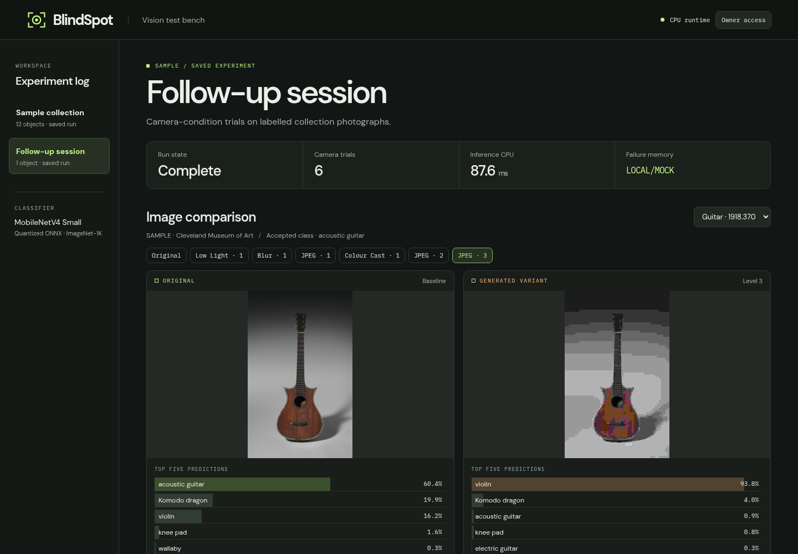

# BlindSpot

**Which camera condition makes my inventory classifier misidentify an object I own?** BlindSpot takes the owner’s label, runs a small vision model on the original photo, chooses a camera test, and uses the measured result to choose the next one. On a sample guitar, severe JPEG compression moved the top prediction from acoustic guitar to violin at 93.8%. The agent asked for a retake.

Built by Damien (XAVORIAN) on November 25 during Fly.io Hacksgiving week. [Open the public Sprite demo](https://blindspot-demo-b6wzw.sprites.app) and select **Sample collection** or **Follow-up session** to inspect the packaged SAMPLE replay. Starting a new experiment requires an unpublished owner token. [Source code](https://github.com/damien15-5/blindspot)

The 76-second captioned walkthrough uses the saved runs. [Walkthrough](evidence/walkthrough.mp4) · [Test results](TEST-RESULTS.md) · [Sprite runbook](DEPLOY.md)



## Live Pinecone verification

On November 25, 2026 (WAT), the public Sprite returned HTTP 200 for an unauthenticated `GET /api/status`, with `memory: "Pinecone"` and `owner: false`. An unauthenticated `POST /api/samples` returned HTTP 403 with “Owner access required”.

The Fly organization’s Pinecone connector holds the bring-your-own Starter key. Its policy sets `allow_all: false` and `sprite_labels: ["blindspot"]`. The `blindspot-demo` Sprite carries that label. From inside the Sprite, the gateway listed the ready `blindspot-memory` index (dense, 1,000 dimensions, cosine, AWS us-east-1).

Both qualification runs used the Sprite service with `BLINDSPOT_MEMORY=pinecone`. The connector traces recorded these Pinecone POST requests.

| Run | `/indexes/<index>/query` | `/indexes/<index>/vectors/upsert` |
|---|---|---|
| SAMPLE · `5eefca5287024149aa150ac503d092ac` | HTTP 200, 744 ms | HTTP 200, 848 ms |
| FOLLOW-UP · `2d266cdb3b104cf78f7fbad83bb904b0` | HTTP 200, 493 ms | HTTP 200, 885 ms |

Eleven of the twelve museum photos were baseline errors. The classifier recognized guitar 1918.374 in the original, blurred and rotated photos. Low light and JPEG each induced an error. BlindSpot saved the low-light failure in Pinecone.

On held-out guitar 1918.370, the first decision after the original had reason code `RECALLED_FAILURE`. Pinecone recall moved low light ahead of the usual first test, blur. The classifier kept the guitar label through low light, blur, JPEG L1, colour cast and JPEG L2. JPEG L3 produced a confident error.

## Run the test bench locally

From this directory on Linux with Python 3.13, run the following commands. The compiled React interface and sample replays ship with the repository. The public model fetch verifies its pinned hashes and skips files already present.

```bash
mkdir -p .local/tmp
python3 -m venv .local/venv
.local/venv/bin/python -m pip install -r requirements.txt
.local/venv/bin/python scripts/fetch_model.py
./start.sh
```

Open **http://127.0.0.1:8080**. The default viewer displays saved evidence. Select **Sample collection** for the first session or **Follow-up session** to see how retrieval changed the next experiment. Click a trial for the image pair and top five. The JSON download includes the complete run.

For an owner session, stop the viewer and launch the same app with a local access token of your choosing. The token protects app controls and is unrelated to a provider credential.

```bash
read -rsp 'Choose a local owner token: ' BLINDSPOT_OWNER_TOKEN
echo
export BLINDSPOT_OWNER_TOKEN
BLINDSPOT_MODE=owner BLINDSPOT_MEMORY=local ./start.sh
```

1. Open **Owner access**, enter the token and select **Owner workspace**.
2. Select **Load 12 samples** and **Create run**. Open **Owner controls** and choose **Continue experiment** for a bounded slice, or **Run next step** for one decision at a time.
3. After completion, choose **Load follow-up** and create another run. It uses a distinct sample photo. Retrieval and inference execute on this request.
4. For Damien’s own camera, upload JPEG, PNG or WebP files in **Owner controls**. Search the class list by name, enter one or more accepted numeric IDs separated by commas, and import the photo. Select up to twelve photos for a run. If a label is missing, select the photo, save its accepted IDs, then continue. A retake starts a new run and preserves the earlier evidence.
5. Download the report as JSON or choose **Export HTML**. The HTML contains the actual image bytes and opens offline. SQLite and completed report files live under `data/` by default.

## What the classifier actually did

| Sample | Condition | Top prediction | Agent evidence |
|---|---|---|---|
| First set, 12 originals | Baseline | 1 of 12 matched | Eleven retake requests before any corruption tests |
| Guitar 1918.374 | Original → mild blur | Acoustic guitar 65.1% → 89.4% | Label held |
| Guitar 1918.374 | Brightness ×0.65 | Komodo dragon 33.8% | Guitar fell to 5.1%. First failure stored |
| Guitar 1918.374 | JPEG quality 30 | Komodo dragon 35.4% | Another induced error |
| Guitar 1918.370, follow-up | Recalled low light, tested first | Acoustic guitar 66.4% | Original scored 60.4%. Low light held on this photo |
| Guitar 1918.370 | JPEG quality 12 → 4 | Acoustic guitar 45.9% → violin 93.8% | Retake at quality 4 |

The two runs contained 13 originals and 12 variants. Five variants disagreed with the accepted label. Only one crossed the operational 70% wrong-class threshold. The twelve-photo set and the separate follow-up use project labels and CC0 museum photographs. Guitar selection included development screening. These results describe the chosen files and pinned model, with limited relevance to other cameras and objects. [Per-file attribution](samples/ATTRIBUTION.md) · [Full evidence](TEST-RESULTS.md)

## Why a personal agent on a Sprite

Damien supplies the objects, labels and session budget. A deterministic policy does the planning. The persistent filesystem holds the model, original photos, decisions, image pairs and queued writes between sessions. An HTTP service can wake to handle the next owner request. The UI refreshes on explicit actions and opens no continuous connection. The app uses no generative LLM or paid inference service.

| Component | What it does |
|---|---|
| FastAPI + SQLite | One active run, immutable label snapshots after baseline, cursor-checked steps, hash-keyed artifacts and durable memory-write intents |
| Pillow + NumPy + ONNX Runtime | EXIF orientation, RGB, working copy up to 768 px, bicubic shortest edge 256, center crop 224, rescale and channel normalization from pinned config. One CPU thread, named logits output, one softmax, top five |
| Test selection | Probe blur radius 1.2, brightness ×0.65, JPEG quality 30 and one extra condition chosen by seed and photo position. A qualifying memory hit gets first place. Extras include rotation, occlusion, colour cast and glare. Escalate the condition with the largest approved-label probability loss. Stop at six variants, exhausted budget, no loss after mild probes, or a confident error |
| Failure memory | L2-normalized 1,000-dimensional baseline probabilities describe similarity of classifier responses. Retrieve up to three cases for the same owner and model. A cosine score of at least 0.15 can promote a previously failing condition. Store the first induced error per run/photo |
| Pinecone adapter | Sprites gateway query and upsert, cosine index and stable case IDs. Failed queries use the documented default policy and record an unavailable decision. Failed upserts stay pending for explicit retry. Default LOCAL/MOCK performs real cosine search in-process over SQLite-backed cases |
| Optional Box adapter | Owner-triggered intake of labelled files and export to a new HTML filename. File versions support caching. Configure paths from the actual gateway panel. Adapter tests used simulated responses |
| React + TypeScript | Read-only sample replay or token-gated owner workspace. Ranked scores, generated variants, reason codes, memory evidence, request traces and downloadable reports |

The model artifact has 3,931,745 bytes. Revision, weights, preprocessing and label-config hashes are recorded in the manifest. Run reports also contain the input photo hash, output image hash, accepted IDs, seed, transform level and measured inference CPU time. [Pinned manifest](models/manifest.json) · [Upstream model](https://huggingface.co/onnx-community/mobilenetv4_conv_small.e2400_r224_in1k)

## Verification and entry materials

```bash
.local/venv/bin/python -m pytest -q --basetemp=.local/tmp/pytest
.local/venv/bin/python scripts/smoke.py --data .local/my-fresh-smoke
(cd web && npm ci && npm run build)
node web/browser.mjs
```

Choose an empty smoke directory. Browser acceptance requires local Chrome and Node 24. The application itself runs from the checked-in assets. [Test outputs and methodology](TEST-RESULTS.md) · [Demo script](DEMO-SCRIPT.md) · [Social drafts](SOCIAL-DRAFTS.md) · [Form drafts](FORM-DRAFT.md)

MIT applies to project code. Sample images retain their individual CC0 provenance. Fonts and React notices accompany the static build. Model weights are obtained separately from the pinned public repository.
